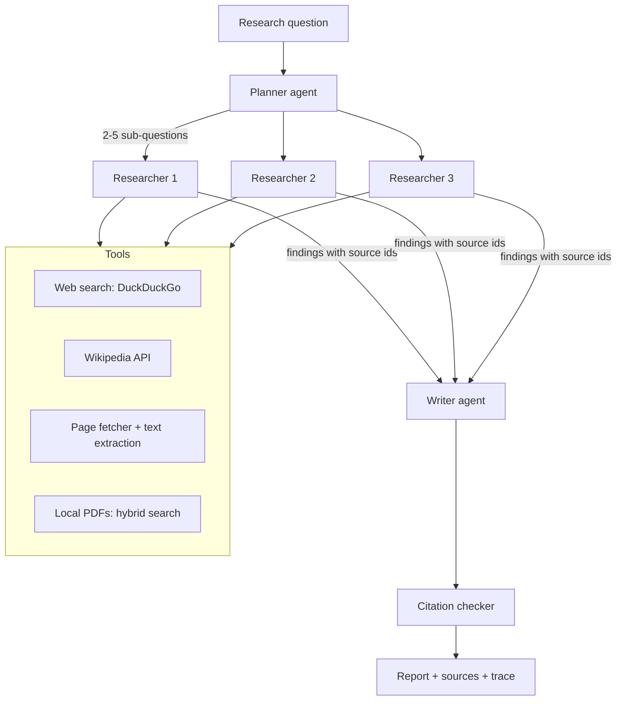

# Project 02: Multi-Agent Research Assistant — Design

> Status: draft for review, November 3, 2026.

## 1. Goal

Accept a research question, split it into focused sub-questions, have one research agent investigate each sub-question using the web and/or local PDFs, and combine the findings into a report where every claim cites a numbered source.

The learning objective is **agent orchestration**: planning, delegating to parallel workers, passing structured results between agents, and checking the final output. The orchestration is written in plain Python with no agent framework, so every step is visible and testable.

## 2. Constraints

| Constraint | Consequence for the design |
|---|---|
| Free and local: Ollama with `qwen3:4b` on an 8 GB M2 | Few, short model calls. Thinking mode off for agent steps. |
| Ollama serves one request at a time on this machine | Search and page fetching run in parallel; model calls run one after another. |
| Measured speed: about 29 tokens/s, thinking off | Target: a report with 3 sub-questions in **about 3 to 4 minutes**, with live progress. |
| Thinking mode broke structured output in testing (empty list after 600 tokens) | Structured steps use `think: false` with a JSON schema in Ollama's `format` field. |
| No paid APIs | Web search through DuckDuckGo (`ddgs` package) and the Wikipedia API, both keyless. |
| Web pages are untrusted input | Page text is treated as data, never as instructions (see Section 8). |

## 3. User Flow

1. The user types a question, for example "How did the printing press change European science?"
2. They choose sources: **Web**, **Local documents** or **Both**, and a depth of 2 to 5 sub-questions (default 3).
3. The app shows the plan (the sub-questions) and live progress for each agent.
4. The final report appears with numbered citations and a source list. Each agent's evidence and notes can be expanded.
5. The report can be downloaded as Markdown.

## 4. Architecture



### 4.1 Orchestrator

`ResearchRun` in `src/orchestrator.py` drives the pipeline. It owns a **source registry** that gives every source a stable number such as `[3]`, so researchers and the writer refer to sources by number and citations can be checked. It emits progress events (`plan_ready`, `searching`, `source_found`, `researcher_done`, `writing`, `done`, `error`), which the UI renders live and the tests assert on.

### 4.2 Agents

Each agent is a small class with one `run()` method, one prompt and, where it returns data, a JSON schema.

| Agent | Input | Output (structured) | Model calls |
|---|---|---|---|
| Planner | Question, depth | `{"sub_questions": [...], "search_queries": [[...], ...]}` | 1 |
| Researcher (one per sub-question) | Sub-question, 3 to 5 source excerpts | `{"findings": [{"claim": "...", "source_ids": [2, 5]}], "gaps": "..."}` | 1 each |
| Writer | Question, all findings | Markdown report with `[n]` citations | 1 |

Total for depth 3: **5 model calls**. Researchers extract short claims tied to source ids instead of writing prose, which keeps the writer's input small and makes citations checkable.

### 4.3 Tools

| Tool | Implementation | Limits |
|---|---|---|
| Web search | `ddgs` text search | 5 results per query, 10 s timeout |
| Wikipedia | MediaWiki search and extracts API (`urllib`) | 2 articles per query, intro plus most relevant section |
| Page fetcher | `urllib` plus `trafilatura` to extract the main text | http/https only, 2 MB max, 10 s timeout, best 1,500 characters per page kept |
| Local documents | Hybrid search (semantic + BM25 + RRF) over a ChromaDB index | 4 chunks per sub-question |

**Local documents decision:** Project 01's `document_processor.py` and `vector_store.py` are **copied** into `src/local_docs/` with a note crediting Project 01. This keeps the repository standalone, so anyone can clone and run it. A setting `LOCAL_DOCS_DB` can point at Project 01's `chroma_db/` to research documents already indexed there. The 14 sample PDFs are included for testing.

**Source selection:** the user chooses the enabled sources; each researcher queries every enabled source. Letting a 4B model choose its own tools was considered and rejected for now because it is unreliable at that size. It is listed as a stretch goal.

## 5. Citations and Checking

- Researchers may only cite source ids that were given to them; any other id is dropped and recorded in the trace.
- The writer may only cite ids that appear in the findings.
- After writing, the citation checker flags any `[n]` that doesn't exist, and any paragraph with no citation, as **unverified**, the same idea as Project 01.
- The source list shows title, URL or `file, page`, and which sub-questions used it.

## 6. Speed Plan

- Thinking mode off for all three agents.
- Source excerpts capped at 1,500 characters, at most 5 per sub-question, so each researcher prompt stays under about 2,500 tokens.
- Search and fetching for all sub-questions start in parallel (`concurrent.futures`, 6 workers) as soon as the plan is ready; researchers run in order as their evidence arrives.
- Context window 8,192 tokens for the writer, 4,096 for the other agents.
- The model is kept loaded between calls (`keep_alive`).

## 7. User Interface (Streamlit)

- Question box, source selector (Web / Local / Both), depth slider.
- Live status: the plan, then one status row per researcher (searching, reading N sources, done).
- The report with clickable citations, followed by the numbered source list.
- Expanders per researcher: queries used, sources read, extracted findings, gaps.
- Download report as Markdown. Total time and number of model calls shown at the bottom.

## 8. Safety

- Fetched text is wrapped in clearly delimited `<source id=n>` blocks, and prompts say to treat it as reference material, not instructions.
- Agents can't take actions; tools only search and read. No code execution, no file writes beyond the local index.
- The fetcher refuses non-http(s) URLs and private or local network addresses.
- Requests send a descriptive User-Agent and respect timeouts.
- The report states that it was generated by a local model and that sources should be checked.

## 9. Testing

- **Unit tests** with a fake model client and fake tools: planner and researcher output parsing, the source registry, citation checking, dropping invalid source ids, error handling when a tool or Ollama fails.
- **Orchestrator tests:** event order, partial failure (one researcher fails and the report is still written with a note), depth limits.
- **Tool tests** with recorded responses, so no network is needed.
- **UI tests** with Streamlit's `AppTest`, as in Project 01.
- **Live smoke test** (opt-in with `RUN_LIVE_TESTS=1`): one real question against Ollama and the web.
- **Evaluation sheet:** 6 fixed questions (3 web, 2 local, 1 mixed) with a checklist covering whether the answer is cited, correct and complete, plus the time taken, recorded in `docs/evaluation.md`.

## 10. Project Structure

```text
app.py                     Streamlit UI
src/orchestrator.py        ResearchRun, source registry, progress events
src/agents.py              Planner, Researcher, Writer
src/llm.py                 Ollama client (JSON schema output, thinking off)
src/tools/web.py           DuckDuckGo search and page fetching
src/tools/wikipedia.py     Wikipedia search and extracts
src/local_docs/            Hybrid search over PDFs (from Project 01)
src/citations.py           Citation checking
data/samples/              Sample PDFs for local research
tests/                     Unit, orchestrator, tool and UI tests
docs/evaluation.md         Evaluation questions and results
```

## 11. Milestones

1. **Core pipeline (command line):** LLM client, planner, researcher and writer with web sources, run as `python -m src.cli "question"`.
2. **Local documents:** copy and adapt Project 01's search; Web / Local / Both switch.
3. **Citation checking** and partial-failure handling.
4. **Streamlit UI** with live progress and agent traces.
5. **Tests, evaluation sheet, README with screenshot.** Then publish and add it to the profile.

Stretch goals, after milestone 5: a **reviewer agent** that reads the draft, lists gaps and triggers one extra research round; letting researchers choose their own tools; a LangGraph version of the same pipeline for comparison.

## 12. Out of Scope

Hosted or paid models, user accounts, saving research history between sessions, and crawling beyond the pages returned by search.
