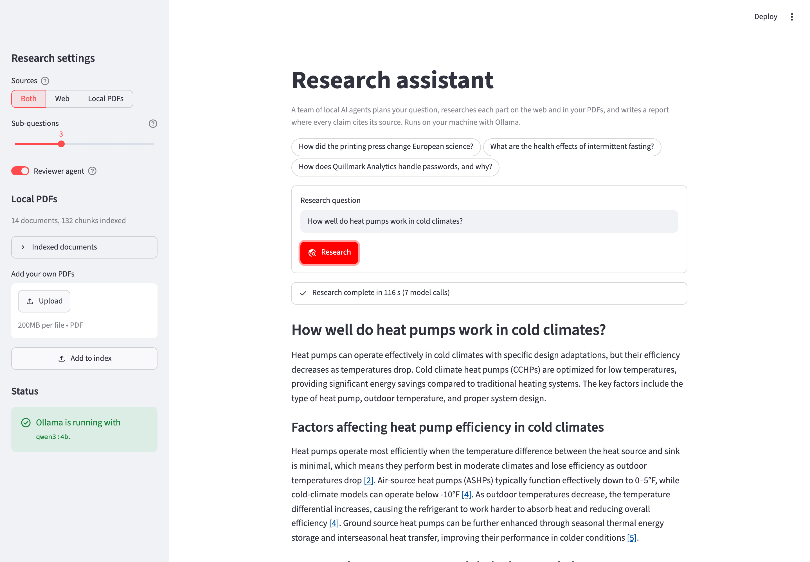
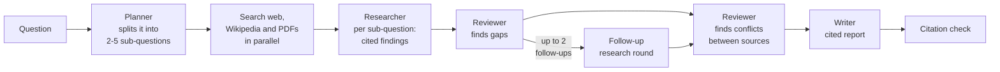
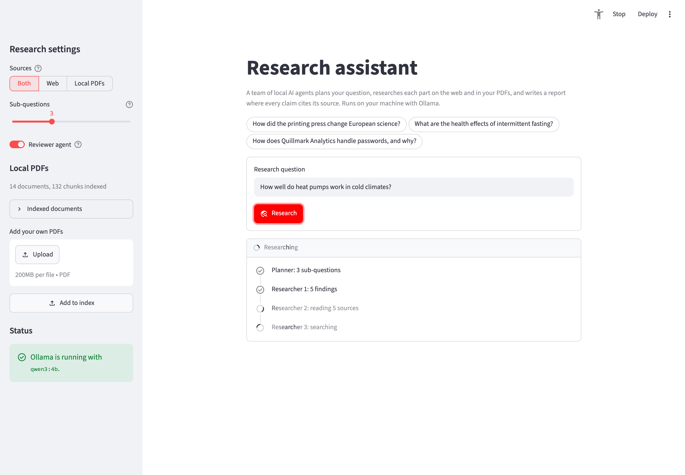

# Multi-Agent Research Assistant

Ask a research question and a team of local AI agents plans it, researches each part on the web and in your own PDFs, checks the findings for gaps and contradictions, and writes a report in which every claim cites its source.

Everything runs on your machine with a small local model (`qwen3:4b` via Ollama). No API keys, no paid services, no agent framework: the orchestration is about 300 lines of plain Python.



## How it works



| Agent | Job | Output |
|---|---|---|
| **Planner** | Rejects non-questions, then splits the question into focused sub-questions with search queries | JSON plan |
| **Researcher** | Reads up to 5 sources for one sub-question and extracts short factual findings, each citing its sources | JSON findings |
| **Reviewer** | Asks for follow-up research where the findings leave gaps, then compares findings for contradictions | Follow-up questions, conflicts |
| **Writer** | Turns the findings into a report, citing every claim and stating conflicts instead of hiding them | JSON sections, assembled into Markdown |

Every model call has one narrow prompt and a JSON schema for its answer (the reviewer makes two calls, the others one). The agents talk only through small typed Python objects, never through free-form chat, so every step can be tested with a fake model.

## Features

- **Live agent timeline**: watch the planner, each researcher and the reviewer work, with the sources each one reads.
- **Three sources**: DuckDuckGo web search, Wikipedia, and your own PDFs (hybrid semantic + keyword search, reused from [Project 01](https://github.com/maheshkarthik/local-rag-document-assistant)). Switch between **Web**, **Local PDFs** and **Both**.
- **Citations you can check**: sources are numbered once per run, web citations link to the page, and a checker flags citations to sources that don't exist and paragraphs with no citation.
- **Guardrails against a small model's mistakes**:
  - findings citing a source the researcher was never shown are dropped
  - the reviewer's conflicts are kept only if they compare findings from *different* sources
  - placeholder text such as "your question here" is rejected instead of researched
  - a slow or failed step falls back gracefully (the raw findings are shown if the writer fails)
- **Safe web fetching**: only public addresses are fetched, every redirect is checked, pages are size-capped, and page text is wrapped as data so instructions inside a page can't steer the agents.
- **Download** the report as Markdown, or run everything from the command line.



## Requirements

- macOS, Linux or Windows; tested on an Apple M2 with 8 GB RAM
- Python 3.12
- [Ollama](https://ollama.com) with the `qwen3:4b` model (about 2.5 GB on disk)
- An internet connection for web research (local-only research works offline)

## Installation

```bash
git clone https://github.com/maheshkarthik/multi-agent-research-assistant.git
cd multi-agent-research-assistant

python3.12 -m venv .venv
source .venv/bin/activate
pip install -r requirements.txt

# Install Ollama (https://ollama.com/download), then download the model
ollama pull qwen3:4b
```

To research the sample PDFs, index them once (the first run downloads an 80 MB embedding model):

```bash
.venv/bin/python -m src.index
```

Or click **Index sample documents** in the app's sidebar.

## Usage

### Web app

```bash
.venv/bin/streamlit run app.py
```

Pick the sources and the number of sub-questions in the sidebar, then ask a question or click one of the examples. A run makes 7 to 9 model calls and takes about 2 to 4 minutes on an 8 GB M2. Turn off **Reviewer agent** for faster, simpler runs.

### Command line

```bash
.venv/bin/python -m src.cli "How did the printing press change European science?"
.venv/bin/python -m src.cli "How does Quillmark Analytics handle passwords?" --sources local --depth 2 --output report.md
```

| Option | Default | Meaning |
|---|---|---|
| `--sources` | `both` | `web`, `local` or `both` |
| `--depth` | `3` | number of sub-questions, 2 to 5 |
| `--no-review` | off | skip the reviewer and its follow-up research |
| `--output` | none | save the report as Markdown |

## Evaluation

Six fixed questions (3 web, 2 local PDFs, 1 mixed) were run end to end with the default settings and scored by hand. See [`docs/evaluation.md`](docs/evaluation.md) for the scores and notes, and [`docs/examples/`](docs/examples/) for the full reports.

| Result | Questions |
|---|---|
| Good: correct, cited, complete | intermittent fasting, heat pumps in cold climates, fall of the Roman Republic |
| Partial | password policy (overstates one rule, misses a conflict), printing press and science (thin on specific scientific works) |
| Half right | incident postmortem: root cause correct, but the page listing corrective actions was never retrieved |

Every run finished with a cited report, in 98 to 237 seconds. The evaluation also found five bugs that unit tests couldn't. The biggest: qwen3 wrote 2,000+ tokens of planning before every report even with thinking off; asking the writer for JSON sections fixed it and cut writing time from about 120 s to 15 s.

## Design notes

- **Why no agent framework?** The flow is a fixed pipeline with one loop (the follow-up round). In plain Python every step is visible, testable with a fake model, and easy to explain. [`DESIGN.md`](DESIGN.md) covers the decisions and the alternatives considered.
- **Why a 4B model?** It's the largest that runs comfortably in 8 GB of RAM. The design leans on structure instead of model size: JSON-schema output, one narrow job per call, and code that validates every answer.
- **Parallel where it helps**: web and PDF searches for all sub-questions run at once, while model calls run one at a time because a local Ollama serves one request at a time.

## Configuration

| Variable | Default | Purpose |
|---|---|---|
| `OLLAMA_URL` | `http://localhost:11434` | Where Ollama is listening |
| `OLLAMA_MODEL` | `qwen3:4b` | Which model the agents use |
| `LOCAL_DOCS_DB` | `./chroma_db` | Where the PDF index is stored (point it at Project 01's index to reuse it) |

## Running the tests

```bash
.venv/bin/python -m unittest discover -s tests -t . -v
```

The 177 tests use a fake model, fake search tools and temporary databases, so they need neither Ollama nor the internet. They cover each agent, the orchestrator's ordering and failure handling, the search tools (including redirect and private-address blocking), the PDF search and the Streamlit UI.

## Project structure

```text
app.py                     Streamlit UI with the live agent timeline
src/orchestrator.py        ResearchRun: plan, search, research, review, write, check
src/agents.py              Planner, Researcher, Reviewer and Writer prompts and validation
src/llm.py                 Ollama client (JSON schema output, thinking off)
src/sources.py             Evidence and the numbered source registry
src/citations.py           Citation checking
src/report.py              Citation links and Markdown formatting
src/tools/web.py           DuckDuckGo search and safe page fetching
src/tools/wikipedia.py     Wikipedia search and extracts
src/tools/local.py         Research tool over the indexed PDFs
src/local_docs/            Hybrid PDF search, reused from Project 01
src/cli.py, src/index.py   Command-line research and PDF indexing
tests/                     Unit, pipeline, tool and UI tests
data/samples/              14 sample PDFs (CC0)
docs/                      Screenshots, evaluation and example reports
```

## Limitations

- A 4B model is slow and imperfect: it sometimes overstates a claim, asks narrow sub-questions, or misses a contradiction. The conflict check catches some disagreements between sources, not all of them. Check important facts against the cited sources.
- Most of the sample PDFs are fictional. In **Both** mode, a report can mix real web facts with invented sample facts.
- Search results depend on DuckDuckGo, which can rate-limit heavy use.

## License

The code is released under the [MIT License](LICENSE). The sample documents in `data/samples/` are released under [CC0](https://creativecommons.org/publicdomain/zero/1.0/).
